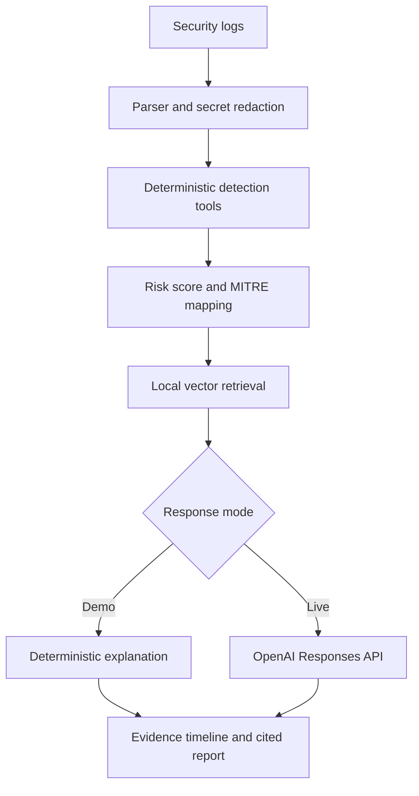

# TraceGuard AI

[**Launch the Live Demo →**](https://traceguard-ai.onrender.com)

**An explainable SOC copilot that shows its work.**

TraceGuard AI analyzes security logs, identifies attack patterns, maps evidence to MITRE ATT&CK,
retrieves relevant defensive guidance, and produces a cited incident explanation. It was built by
**Zain Latif, a Computer Science student at UMBC with a cybersecurity background**, to solve a
specific problem: junior analysts are often given an alert without being taught why it matters.

The project therefore has two voices:

- **SOC Analyst** gives a concise incident handoff.
- **Teach Me** explains the evidence-to-conclusion chain in beginner-friendly language.

## What makes it different

Most portfolio chatbots hide their reasoning behind a model response. TraceGuard makes the
important security decisions deterministic and auditable:

1. It parses each event and applies visible detection rules.
2. Every warning sign adds named points to a transparent `0–100` risk score.
3. Findings are mapped to MITRE ATT&CK techniques.
4. The retriever selects relevant defensive sources from a local vector store.
5. The LLM explains the evidence but is not allowed to invent the evidence.

The included **demo mode works with no API key**, so recruiters can try the full workflow safely in the [public live demo](https://traceguard-ai.onrender.com).

## Architecture



## October 2026: PHP2Shell advisory support

TraceGuard now recognizes explicit PHP software inventory events and flags runtimes below
upstream PHP2Shell fixes (CVE-2026-109618 and CVE-2026-109619): PHP 8.2.35,
8.3.36, 8.4.27, and 8.5.12. A version observation is a patch-priority signal,
**not evidence that a host has been exploited**. Verify vendor backports and upgrade
unsupported releases. Click **PHP2Shell patch scenario** in the public demo to try a
synthetic example. This does not patch third-party PHP servers, and the TraceGuard
backend itself runs Python rather than PHP.

Dependency update pull requests for Python, Docker, and GitHub Actions are now enabled
through Dependabot; updates still require CI review and merge.

## Features

- JSON Lines and common SSH authentication-log parsing
- Brute-force, post-failure success, privilege-change, malware, and exfiltration detections
- Transparent risk factors and a capped 100-point score
- MITRE ATT&CK mappings such as T1110, T1078, T1098, and T1048
- Retrieval-augmented generation with a SQLite vector store
- Source citations and retrieval similarity scores
- Evidence timeline and recommended containment actions
- Prompt-injection boundary for untrusted log data
- Common secret and private-key redaction before live model calls
- FastAPI backend and responsive custom frontend
- OpenAI Responses API integration with keyless demo fallback
- Automated tests, a five-scenario evaluation set, Docker, and GitHub Actions CI

## Quick start

### Option 1: Python

```bash
git clone https://github.com/zlatif1-source/traceguard-ai.git
cd traceguard-ai
python -m venv .venv
```

Activate the environment:

```bash
# Windows PowerShell
.venv\Scripts\Activate.ps1

# macOS or Linux
source .venv/bin/activate
```

Install and run:

```bash
pip install -r requirements-dev.txt
uvicorn app.main:app --reload
```

Open `http://127.0.0.1:8000` and click **Load attack scenario**.

### Option 2: Docker

```bash
docker compose up --build
```

Then open `http://127.0.0.1:8000`.

## Optional live AI mode

Demo mode is completely local. For a generated report, copy the example environment file:

```bash
cp .env.example .env
```

Add an API key to `.env`, keep that file private, and choose **Live AI** in the interface.

The integration uses the current OpenAI Responses API pattern documented in the
[official text-generation guide](https://developers.openai.com/api/docs/guides/text).

## API example

```bash
curl -X POST http://127.0.0.1:8000/api/analyze \
  -H "Content-Type: application/json" \
  -d '{
    "question": "Explain this alert",
    "logs": "{\"event_type\":\"malware_alert\",\"message\":\"EDR detection\"}",
    "mode": "demo",
    "explanation_mode": "teach_me"
  }'
```

Interactive API documentation is available at `http://127.0.0.1:8000/docs`.

## Tests and evaluations

```bash
pytest --cov=app --cov-report=term-missing
python -m evals.run_evals
ruff check .
```

The evaluation suite checks severity classification and required MITRE mappings across benign
activity, brute force, account takeover, possible exfiltration, and malware scenarios. CI runs the
same checks on every push and pull request.

## Example risk calculation

For the included account-takeover scenario:

| Evidence | Points |
|---|---:|
| Six repeated authentication failures | +12 |
| A successful login from the same source | +40 |
| Privileged access granted | +30 |
| Large outbound transfer | +20 |
| **Total (capped)** | **100/100** |

This score is a portfolio demonstration, not a universal security formula. A production version
would calibrate weights using historical incident data and analyst feedback.

## Resume-ready description

**TraceGuard AI — Python, FastAPI, OpenAI API, RAG, SQLite, Docker, GitHub Actions**

- Built an explainable AI security analyst that parses event logs, detects multistep attack
  behavior, maps findings to MITRE ATT&CK, and generates cited incident-response guidance.
- Implemented a local vector-search pipeline and retrieval-augmented generation workflow with
  transparent similarity scores and a keyless deterministic demo mode.
- Designed an auditable risk-scoring engine, evidence timeline, prompt-injection boundaries, and
  secret-redaction guardrails so model output remains grounded in observable events.
- Created automated tests, a labeled security evaluation dataset, CI checks, Docker packaging,
  structured logging, and latency/provider telemetry.

## Roadmap

- Add PostgreSQL + pgvector for larger knowledge bases
- Import Sigma detection rules
- Add analyst feedback and evaluation history
- Add an MCP server so other agents can call TraceGuard's analysis tools

## Responsible use

TraceGuard is for defensive learning and demonstration. The included logs are synthetic. Do not
send real credentials or sensitive organizational logs to a public deployment. See
[SECURITY.md](SECURITY.md) for the project's safeguards and limitations.

## Author

**Zain Latif** · Computer Science at UMBC · Software Engineering, AI, and Cybersecurity

